# Frame Blur Detection — Update 2

The third published model of [Frame Blur Detection](https://github.com/mschauta/frame-blur-detection), after
[Update 1](https://github.com/mschauta/frame-blur-detection-update-1). It is a blur detector for video frames with the
same input as before: the signed edge fingerprint of the
[RGB Mesh Resampling](https://github.com/mschauta/rgb-mesh-resampling) `m09` reconstruction. It also keeps the same
ConvNeXt-Base trunk and the same synthetic photo pool. What changed is what it learns from and what it gives:

- **It learns from cell maps, not from labels.** Every frame of the 167 training videos (4,850,458 frames, seen once)
  carries Update 1's cell map as a soft target per 16 px cell. A freshly initialised network learns these maps:
  spatial self-distillation. No VLM label is used in training.
- **It gives a blur mass, not a class score.** The frame value M is the mean of the positive cell logits. It is a
  fixed readout of the map, not learned. M = 0 means that no cell says blur. The threshold is chosen when filtering.
- **The blurred photos are stricter:** they start at 10 px of added camera motion instead of 16 px.

This repository holds:

- the loader and `classify.py` for the Update 2 weights (the Update 1 weights load too);
- the evidence behind the reported numbers, in [reproduction/](reproduction/);
- a separate experiment on two videos outside the training data, in
  [experiments/r4k1_codec_frametype/](experiments/r4k1_codec_frametype/). It shows that the coded frame type (I, P or
  B) changes the scores of both Update 1 and Update 2.

The task, the principles, the photo construction and the fingerprint are described in the original repository's
[README](https://github.com/mschauta/frame-blur-detection#readme) and
[METHOD.md](https://github.com/mschauta/frame-blur-detection/blob/main/METHOD.md). Update 1's
[README](https://github.com/mschauta/frame-blur-detection-update-1#readme) tells the development history up to
Update 1. [METHOD.md](METHOD.md) here lists what changed in Update 2, section by section.

## Development history, continued

Sections 1–8 of the history are in Update 1's README. In short:

- Direct sharpness measurement in video could rank frames inside a shot but gave no absolute sharp / blurred boundary.
- A frozen vision-language model (VLM) labelled about one million frames.
- Small, then Base ConvNeXt detectors learned the decision from the edge fingerprint, anchored by synthetic photos
  with a known amount of added camera blur.
- From the start the detectors gave one logit per 16 px cell, pooled into a frame score.

### 9. Update 2: learning from the predecessor's cell maps

After its checkpoint was fixed, Update 1 scored the whole 5.01-million-frame corpus with cell maps. The maps carried
more than the frame score. Many frames that Update 1 called blurred only at its strictest operating point held a
single small blurred spot, such as a hand moving into the picture, while the rest was sharp. One class label per frame
cannot express this.

Update 2 therefore trains the same architecture again on those maps:

- **The start:** ImageNet weights, not Update 1's weights, so the map is learned again rather than inherited.
- **The targets:** each cell's blur probability from Update 1, kept as a soft value, so the strength of the evidence
  is kept.
- **The frame value:** a fixed readout of the map. The learned soft maximum is gone, and every cell that says blur
  adds to the mass in proportion to its area.
- **The photos** still anchor the two ends of the scale, now with blur from 10 px.

A model that learns from its predecessor learns its errors too. Two counterweights:

- **A measurement veto.** Where the non-learned motion measurement sees strong motion but Update 1's map is sharp, the
  cells are not taught.
- **Independent evaluation.** The evaluation uses signals that Update 1 did not produce: the motion measurement, the
  photo ladder of known blur lengths, and the VLM labels of the six held-out films.

### Next

- **The whole corpus scored with Update 2,** frame by frame against Update 1, on trained and held-out frames.
- **A ConvNeXt-Small on the Update 1 recipe,** with the validity-mask leak fixed (Limitations). It has finished
  training; its evaluation follows.
- **Photo anchors through a multi-frame (I/P/B) encode,** after a controlled test. The two-video experiment shows why.

## What changed

| | Update 1 | Update 2 |
|---|---|---|
| frames for training | 589,663 selected, VLM-labelled frames (349,624 sharp, 240,039 blurred) | every frame of the 167 training videos: 4,850,458, no thinning, no class balance |
| frame target | the VLM label of the image | Update 1's cell map as soft per-cell targets; the outer cell ring and measurement-vetoed blocks are not taught |
| photo anchors | 0–3 px sharp, 16–30 px blurred | 0–3 px sharp, **10–30 px** blurred; one photo sample per three frames |
| frame value | log-sum-exp over the cells with a learned sharpness, a sigmoid score with stored thresholds | **blur mass M**, a fixed readout; no stored threshold |
| loss | image-level cross-entropy, plus a dense term on photos | soft cross-entropy per cell only |
| initial weights | torchvision `ConvNeXt_Base_Weights.IMAGENET1K_V1` | the same, not Update 1's weights |
| schedule | 30 epochs × 48,000 samples, cosine decay | 20 epochs = one pass over the frames (6.47 M samples with the photos), warmup–stable–decay, EMA of the weights |
| held out | 3 validation + 3 test films | the same six films |
| result | the last epoch (29) | the last epoch (19), EMA weights |

## Weights

The weight file is attached to the [release](../../releases) (230 MB; not stored in the repository):

| file | sha256 | input | epoch | frame value |
|---|---|---|---|---|
| `v9_base_selfmap_v2_ep019.pt` | `10d6aa1ebe8cb4bf6bb3cd048aaf75edb07fc1bc23a96d1e8a645a87d0f70ba3` | edge fingerprint | 19 (last of 20), EMA | blur mass M |

`v9_base_selfmap_v2` is the training run's name: design v9, ConvNeXt-Base, trained on self-made cell maps, second
run.

**The file.** It holds the state dict and its metadata. Besides the input type, the loader reads four metadata keys:

- `arch`: ConvNeXt-Base;
- `fingerprint`: `fp32`;
- `pooling`: `mass`, the blur-mass readout;
- `crop`: `cells`. The image is cut to whole 16 px cells, so 1920 × 1080 becomes 1920 × 1072, as in training.

The Update 1 and original weight files load unchanged with the same code.

**M.** The built-in M is the mean of max(0, cell logit) over the inner cells. It leaves the outer ring out, as in
training. M is not a probability and has no stored threshold. Any cell count can be used with the map
(`out["local"]`). The author's desktop tool counts every cell, and so did the two-video experiment.

**Reference points** for the built-in M, from the held-out evaluation (Results). Each is the threshold that catches
90, 95 or 98% of the blurred frames of the three validation films:

- r90: M > 0.04731; r95: M > 0.007882; r98: M > 0.000887;
- M > 0 rejects a frame with any blur cell, the strictest choice.

The two-video experiment used 0.05 and 0.25, but it counted every cell, the ring included. A threshold belongs to the
readout it was set on.

```
pip install -r requirements.txt
# put v9_base_selfmap_v2_ep019.pt into weights/
python classify.py --weights weights/v9_base_selfmap_v2_ep019.pt --input frames --output sorted --mass 0.007882
```

`classify.py` calls a frame blurred when M > `--mass`. It reports whether the weight file is a published release
asset (by its sha256) and writes `results.csv` as it goes. `--resume` continues an interrupted run (also after
`--move`), but only with the settings recorded in `run.json`: the weight file, the threshold, the input folder, copy or
move. `--dry-run` only scores, into `results_dry_run.csv`, and never copies or moves. With Update 1's
`round3_base_p99_ep029.pt` it uses that file's stored thresholds (`--recall 90 / 95 / 98`), as before.

Tests (no private data needed; the weight-file tests run when the files are in `weights/`):

```
pip install pytest
python -m pytest
```

What they cover:

- the fingerprint and the model input;
- the blur-mass readout: inner cells only, masked cells left out, the clamp at 0;
- the whole-cell crop and the shapes;
- loading of old and new weight files, with reference outputs of the published file;
- the evidence files: strict JSON, and the numbers quoted here;
- `classify.py` with both kinds of weight file.

One test is an expected failure: the validity-mask leak described under Limitations.

The model expects what it was trained on: **video frames decoded from H.264** (1080p in training), stored losslessly.

## Results

### The held-out films during training

The per-epoch evaluation measured 16,056 frames of the six held-out films: a fixed hash-chosen ~10% of their frames,
none of them trained on ([training_eval.json](reproduction/training_eval.json)). Last epoch:

| | Update 2, epoch 19 | Update 1 |
|---|---|---|
| fit to Update 1's maps, soft cross-entropy (nats) | 0.0647, of which 0.0461 is the targets' own entropy | — |
| Spearman correlation of M with Update 1's M (from its own map) | 0.973 | — |
| Spearman correlation with the measured region motion | 0.685 | 0.691 |
| frames with M = 0 | 29.1% | 17.8% |
| validation photos (0–3 px against 10–30 px): AUC | 1.000 | — |
| sharp photos with M = 0 / median M of the blurred photos | 99.95% / 20.6 | — |

- **The fit.** The targets' own entropy (0.0461) is the lowest cross-entropy any model can reach. Above it, Update 2
  is at 0.0186.
  - Most of the last gain came in the decay phase: 0.0226 → 0.0186 (−17.5%) in epochs 16–19, against
    0.0257 → 0.0226 (−12%) in the ten constant epochs 5–15.
  - The gap between held-out and training frames is 0.0079 raw, and only 0.0026 once their different target
    entropies are removed. It narrowed during the decay, so lowering the noise did not cost generalisation.
- **The motion measurement** was never a model input and is not learned. Against it, Update 2 is as consistent as
  Update 1 (0.685 vs 0.691).
- **Ties.** Update 2 calls more frames fully sharp: 29.1% have M = 0, against 17.8% for Update 1's own M. In
  distribution, its zero point sits where Update 1's strongest inner cell is at most about +0.5 logit (30.6% of the
  frames). This is a match of shares, not of frames.
  - Frames with M = 0 tie: **M does not rank them.**
  - The map still does: the cell logits below 0 differ, and the strongest cell or the mean cell logit can break the
    ties. On the photo ladder that order means sharper (below); on frames it is not shown.

### Photo ladder

This is Update 1's ladder, unchanged ([photo_ladder_epoch19.json](reproduction/photo_ladder_epoch19.json); Update 1:
[photo_ladder_update1_epoch29.json](reproduction/photo_ladder_update1_epoch29.json)):

- the same 300 unseen photos from the validation and test split of the photo pool, never trained on;
- uniform linear camera motion of known length L, one fixed direction per photo, applied in linear light;
- H.264 CRF 23.



- **The decision flips at about 6.9 px** at all three points (M > 0: 6.85 px, M > 0.05: 6.92 px, M > 0.25:
  6.93 px), against about 9.1 px for Update 1.
  - From 0 to 2.5 px no inner cell says blur on any photo. At 3 and 4 px one photo of 300 has a weak one (M below
    0.05). At 5 px 4 photos have M > 0, at 6 px 40 (13%), at 8 px 299.
  - The flip moved down by about 2 px, most likely because the blurred class now starts at 10 px instead of 16 px.
    It falls inside the untrained 4–9 px gap.
- **M does not rank inside the sharp range.** Within 0–3 px, 99.9% of the pairs of lengths of the same photo tie at
  M = 0.
- **The map does, on these photos.** The mean inner cell logit, a tie-free readout, puts the longer blur higher in
  82.4% of those pairs (17.6% reversed). It rises strictly from 0 to 1, 2 and 3 px on 54% of the photos. Update 1's
  image logit managed 61.7% and 21.3%. From 3 to 16 px the two are 99.6% and 99.2%. This holds for uniform camera
  blur on photos. Whether the same readout ranks frames by sharpness is not shown.
- **Above the flip M saturates:** median 16.5 at 8 px, 19.9 at 10 px, 21.4 at 16–20 px, 20.9 at 30 px. M says how
  much of the picture is blurred and how surely, not how long the blur is.
- **Counting the outer ring** adds a positive border cell on one photo from 0.5 px on, and 12 more photos at 6 px
  (52 instead of 40).

### VLM labels on the held-out films

Every VLM-labelled frame of the six held-out films was scored once with the published file, after the checkpoint
had been fixed: 114,687 frames (71,010 sharp, 43,677 blurred), the frames on which Update 1 reported AUC 0.963. They
are compared with Update 1's scores of the same frames ([heldout_films.json](reproduction/heldout_films.json)). The
95% intervals come from a cluster bootstrap over shots, with the same resamples for both models, so the difference
is paired.

| AUC against the VLM labels | Update 2 (M) | Update 1 | difference |
|---|---|---|---|
| validation films (3) | 0.957 | 0.958 | −0.0012 [−0.0031, +0.0005] |
| test films (3) | 0.960 | 0.966 | −0.0064 [−0.0099, −0.0036] |
| all six | 0.959 [0.950, 0.966] | 0.963 [0.955, 0.969] | −0.0041 [−0.0060, −0.0024] |

- **Update 2 agrees slightly less with the VLM labels than Update 1.** It is lower on five of the six films, by
  0.0017 to 0.0133, and higher on one, by 0.0004.
- **The labels are Update 1's kind of target, not Update 2's.** Update 1 was trained on VLM labels of other films.
  Update 2 never saw one: it learned Update 1's maps. Some loss of agreement with these labels is expected from
  learning through Update 1. The labels are not ground truth either, so where the two models differ they do not
  say which one is right.
- **At equal catch, Update 2 keeps fewer sharp frames at the strict points.** Both models' thresholds come from the
  three validation films (Update 2: the M that catches 90 / 95 / 98% of their blurred frames; Update 1: its stored
  thresholds). Applied unchanged to the test films:

  | test films | Update 2 threshold | Update 2: sharp kept / blurred caught | Update 1: sharp kept / blurred caught |
  |---|---|---|---|
  | r90 | M > 0.04731 | 88.3% / 92.4% | 89.2% / 92.2% |
  | r95 | M > 0.007882 | 77.2% / 95.4% | 81.0% / 95.3% |
  | r98 | M > 0.000887 | 64.1% / 96.9% | 69.8% / 97.0% |
  | M > 0 | | 49.1% / 97.8% | |

- **The outer ring does not matter here.** M over every cell gives the same AUC as the built-in M (0.9586 and
  0.9585).
- **The tie-free readouts are weaker frame scores** (exploratory): the mean inner cell logit reaches AUC 0.922, the
  strongest inner cell 0.954. Whether the mean cell logit orders the frames inside the M = 0 block is not tested
  here.
- **M = 0** on 43.6% of the sharp and 1.5% of the blurred labelled frames.

### Two videos outside the training data: the coded frame type matters

[experiments/r4k1_codec_frametype/](experiments/r4k1_codec_frametype/) is a case study with a fixed analysis plan.
Update 1 (`round3`) and Update 2 (`v9`) scored every frame of two H.264 videos that neither model was trained on:

- **video A:** a drama-series episode, 2.6 Mbit/s, 62,674 frames;
- **video B:** a studio web release, 5.7 Mbit/s, 29,833 frames.

The [report](experiments/r4k1_codec_frametype/REPORT.md) has nine analyses, the verdicts on seven hypotheses and the
limitations, plus 12 tables and 6 figures. The code, the per-frame data and a manifest of SHA-256 hashes are in the
folder. From the per-frame data the code reproduces every result file, table and figure byte for byte. Its packages
are pinned in [requirements-experiments.txt](requirements-experiments.txt).

- **Inside a shot, both models score the I-frame sharper than its P/B neighbours,** although the neighbours show the
  same picture.
  - On A, Update 1 scores the shot-start I-frame sharper than the next two frames in 93.4% of 1,206 comparisons
    [91.5, 95.3]; Update 2 in 86.2%.
  - On B, mid-shot: 68.1% [64.5, 72.3] and 39.0%. On B, 37.0% of Update 2's comparisons are ties.
- **The effect is confined to the I-frame itself.** Motion between the two frames does not explain it, and neither
  does the coded size within a frame type.
- **It matters most where frames are ranked.** Pick the sharpest frame of each 20 s window, and the pick is an
  I-frame far more often than the I-frame share predicts:

  | | Update 1 | Update 2 |
  |---|---|---|
  | video A | 76× | 41× |
  | video B | 32× | 1.7× |

  Update 2's smaller numbers come mostly from its M = 0 ties. Ranked by its tie-free mean cell logit, they are 76× and
  13× (exploratory).
- **At equal acceptance shares** the two models agree on 88–98% of the frames of each type.

The likely origin is the training: every training photo passed through x264 as a single intra-coded frame, so neither
model saw a sharp inter-coded frame with a known label.

## Limitations

- **The teacher is Update 1.** Update 2 learned Update 1's maps, errors included, and its agreement with them is not
  accuracy. The independent witnesses so far:
  - the motion measurement: equal to Update 1;
  - the photos: exact, but only uniform camera blur, and only taught at the two ends of the scale. On the ladder
    Update 2 flips at 6.9 px, inside the untrained gap;
  - the VLM labels, Update 1's kind of target: AUC 0.959 against Update 1's 0.963, and fewer sharp frames kept at
    the strict points.
- **No ranking inside the M = 0 block** (29% of the held-out frames), which matters for picking the sharpest frame
  of a time window. The mean cell logit breaks the ties. On the photo ladder it orders 82% of the 0–3 px pairs, but
  on frames it is not validated.
- **The coded frame type changes the scores** (two-video experiment): I-frames score sharper than their P/B
  neighbours. On low-bitrate encodes, comparisons and selections across frame types are biased.
  - The experiment is observational: the encoders chose the frame types. An I-frame differs from its neighbours in
    frame type, quantiser and bits at once.
  - On video B the fixed GOP places the I-frames independently of the content, but nothing here separates the frame
    type from its quantiser. A controlled re-encode would: the same source frames under different GOP structures and
    quantisers.
- **Area weighting.** A small, strongly blurred region adds little mass. This tolerates background defocus better
  than Update 1, but it also tolerates a small blurred subject, such as a fast-moving hand.
- **The outer cell ring was not taught.** The built-in M leaves it out; a readout that counts it adds untaught
  evidence.
- **Watermarks.** Frames were trained without validity masks: the watermarks were visible, with Update 1's unmasked
  judgement as the target. Validity masks occurred only on photos.
- **The validity-mask leak of Update 1 remains in the loader.**
  - Next to a mask, the fingerprint of a valid pixel is computed from masked neighbours, and those pixels enter the
    p99 scale.
  - Update 2 was trained with this behaviour on the masked half of its photo samples.
  - It is therefore documented and tested (`tests/test_model.py`, expected failure), not changed. `classify.py` uses
    no mask.
- **Uncoded images are outside the training distribution.** Captions, overlaid graphics and animation are out of
  scope.
- **Not yet evaluated:**
  - the whole corpus;
  - the two releases of the same films;
  - Update 1's scene-consistency check.

## Data availability

As in the earlier repositories, the training data is **not published**: it was built from copyrighted videos and
photographs. No images, frames, crops or derived images from it are published. Published are:

- the method;
- the aggregate evidence;
- the inference code and the trained weights;
- the per-frame numbers of the two-video experiment. These hold no image content, and the videos are not named.

## Related work by the author

- [Frame Blur Detection](https://github.com/mschauta/frame-blur-detection): the method, the RGB / grayscale / edge
  fingerprint comparison and the first published weights.
- [Frame Blur Detection — Update 1](https://github.com/mschauta/frame-blur-detection-update-1): the larger corpus,
  ConvNeXt-Base, the float32 fingerprint, and the teacher of this model.
- [RGB Mesh Resampling](https://github.com/mschauta/rgb-mesh-resampling): the continuous RGB-mesh reconstruction from
  which the edge fingerprint is derived.

## License

[MIT](LICENSE) © Dr. Schauta Marcell
